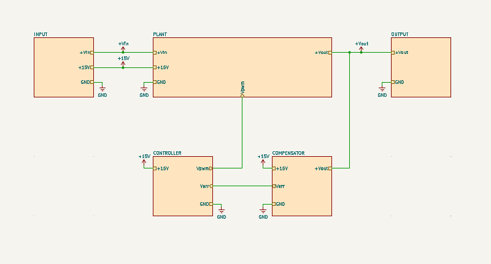
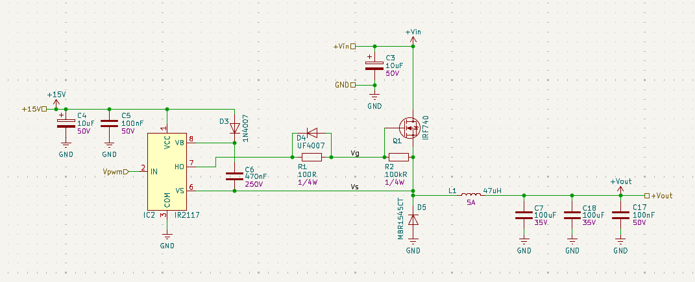
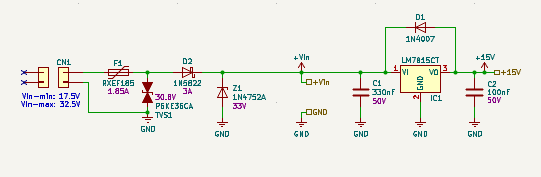
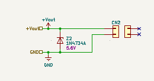
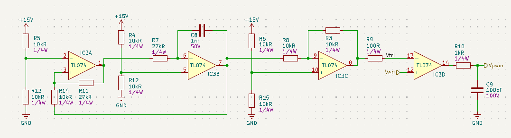
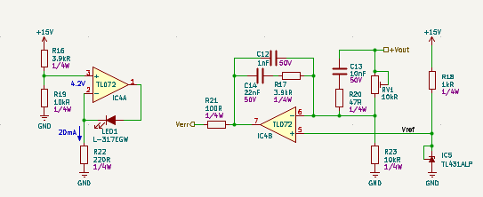
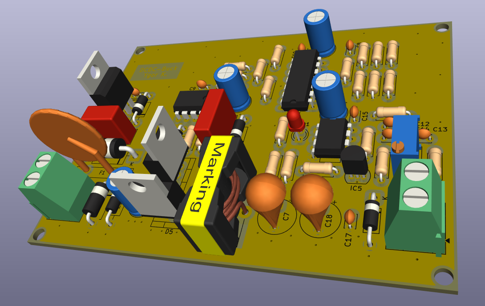

# DCDC-Buck-KiCAD

DC-DC buck converter KiCAD project using OpAmps to compensate and control switching. KiCAD v10 used. Circuit simulated in [this](https://github.com/ykupas/DCDC-Buck-Converter) repository.

## Schematics

## Plant

## Input

## Output

## Controller

## Compensator

## PCB

